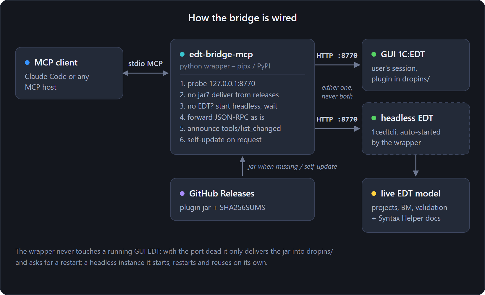

# EDT-Bridge


EDT-Bridge is a 1C:EDT plugin that provides AI agents and other tools with access to EDT's semantic
model over the Model Context Protocol (MCP). The plugin requires a running EDT instance with the
project open, either in the GUI or in headless mode.

The tools provide EDT diagnostics, metadata structure and types, semantic references, and the
platform Syntax Helper supplied with EDT. They validate queries against project metadata,
create and rename objects, and build and deliver them. They also support infobase operations and
debugging. These operations use EDT's own engine.

> The server is available only on localhost. Model-changing tools require a token and return a
> plan by default. Debug tools also require a token.

**English** · [Русский](docs/ru/README.ru.md)

**Documentation: [docs.keyfire.ru/edt-bridge](https://docs.keyfire.ru/edt-bridge/)**

Development notes and updates (in Russian): the [1C × AI: engineering workshop](https://t.me/ceh_1c_ai) Telegram channel.



## Install (recommended: pipx)

The [**edt-bridge-mcp**](python/README.md) wrapper runs as a stdio MCP server for the client and
forwards requests to EDT. If EDT is not running, the wrapper starts it in headless mode. If the
plugin jar is missing from EDT's `dropins/`, the wrapper installs it.

```bash
pipx install edt-bridge-mcp
```

Then register it with your MCP client. Claude Code is shown here; `--workspace` is the EDT workspace
to serve when the wrapper starts a headless EDT:

```bash
claude mcp add edt-bridge -- edt-bridge-mcp --workspace "D:\\path\\to\\edt-workspace"
```

The [quick start](https://docs.keyfire.ru/edt-bridge/onboarding/) covers installing `pipx`, checking the connection and
updating. To run the plugin without the wrapper, see [Installation](https://docs.keyfire.ru/edt-bridge/install/).

## Tools

<!-- tools:start -->

The catalogue is divided by what a tool reads or changes. Each page has a table of its
tools and the details of their parameters and results.

| Group | What its tools do |
|-------|-------------------|
| <a id="read"></a><a id="project-and-runtime-diagnostics"></a>[Read: diagnostics and reference](https://docs.keyfire.ru/edt-bridge/tools/read-diagnostics/) | Projects and validation problems, support status, check descriptions, tool and property reference, the Syntax Helper. |
| [Read: metadata, code and queries](https://docs.keyfire.ru/edt-bridge/tools/read-metadata/) | Metadata objects and their structure, role rights, the command interface, references and calls, module text, search, query validation. |
| <a id="managed-form-preview"></a>[Read: forms and templates](https://docs.keyfire.ru/edt-bridge/tools/read-forms/) | Form structure and rendering, pictures, HTML, data composition and spreadsheet templates. |
| <a id="write"></a><a id="register-fields"></a>[Write: metadata objects](https://docs.keyfire.ru/edt-bridge/tools/write-objects/) | Create, delete and rename objects; attributes and register fields; common-module flags, subsystems, role rights, the command interface, adoption into an extension. |
| <a id="replace-an-existing-bsl-method"></a>[Write: modules](https://docs.keyfire.ru/edt-bridge/tools/write-modules/) | Add, replace, move and delete methods; module fragments; HTTP service routes; quick fixes. |
| <a id="placement-properties-and-validation-snapshots"></a>[Write: forms](https://docs.keyfire.ru/edt-bridge/tools/write-forms/) | Forms, their attributes, commands, handlers and items; audit and repair of duplicate IDs. |
| <a id="html-source-form-ids-and-validation"></a>[Write: templates](https://docs.keyfire.ru/edt-bridge/tools/write-templates/) | HTML templates, data composition schemas, spreadsheet templates. |
| [Write: projects and builds](https://docs.keyfire.ru/edt-bridge/tools/write-projects/) | Extension and external object projects, import, cleaning and deletion; `.cfe`, `.epf` and `.erf` builds; EDT applications. |
| <a id="infobases-the-cluster-and-the-platform"></a><a id="check-platform-build-readiness"></a><a id="incremental-configuration-loading"></a>[Infobases, the cluster and the platform](https://docs.keyfire.ru/edt-bridge/tools/infobases/) | Infobase update and dump, configurator agents, extensions in an infobase, cluster sessions, platform installations. |
| <a id="debug"></a>[Debug](https://docs.keyfire.ru/edt-bridge/tools/debug/) | Attach to a debug server, inspect threads and variables, step through code, evaluate expressions. |

<!-- tools:end -->

## Documentation

| Page | What it covers |
|------|----------------|
| [Quick start](https://docs.keyfire.ru/edt-bridge/onboarding/) | From an empty machine to a working bridge: install, connect, verify, update. |
| <a name="requirements"></a><a name="manual-install-without-the-wrapper"></a>[Installation](https://docs.keyfire.ru/edt-bridge/install/) | Requirements, manual install without the wrapper, the repository scripts that start EDT. |
| <a name="settings-inside-edt"></a>[Settings](https://docs.keyfire.ru/edt-bridge/settings/) | The preference page in EDT, the `EDT_BRIDGE_*` environment variables, the write scope. |
| [Headless EDT](https://docs.keyfire.ru/edt-bridge/headless/) | Auto-start, waiting for the project models in a CI job, moving a ready workspace. |
| [Wrapper plugins](https://docs.keyfire.ru/edt-bridge/plugins/) | Installing, updating and writing plugins for the wrapper. |
| <a name="build-from-source"></a>[Build from source](https://docs.keyfire.ru/edt-bridge/build/) | The JDK and the bundle pool the build needs, the build scripts, releases. |
| [Tools](https://docs.keyfire.ru/edt-bridge/tools/) | Naming rules, plan and apply, and the catalogue by group. |
| [Commands](https://docs.keyfire.ru/edt-bridge/cli/) | The `edt-bridge-mcp` command reference. |
| [Native form checks](https://docs.keyfire.ru/edt-bridge/native-forms/) | Checking forms in the platform's test client with JSON scenarios. |
| [Security](https://docs.keyfire.ru/edt-bridge/security/) | The threat model and how to report a vulnerability. |
| [Changelog](https://docs.keyfire.ru/edt-bridge/changelog/) | What changed from release to release. |

<a name="the-page-in-a-browser"></a>A running bridge also has a status page at `http://127.0.0.1:8770/`:
the server, the open EDT projects, and a runner for every tool.

## Reporting issues

EDT-Bridge is young, and its tools have rough edges. If something behaves unexpectedly or fails, or
if you want a feature, open a **[GitHub issue](https://github.com/keyfire/edt-bridge/issues)**.
Write what you did, what you expected, and what the tool answered. The relevant line of the EDT log
helps too.

## Security

The server binds `127.0.0.1` only. Model-changing tools and debug tools require a token, and a
model-changing tool returns a plan until `apply=true` is passed. The
[Security](https://docs.keyfire.ru/edt-bridge/security/) page has the threat model. Report a security problem privately
through [SECURITY.md](SECURITY.md), not a public issue.

## Contributing

Bug reports and pull requests are welcome. [CONTRIBUTING.md](CONTRIBUTING.md) covers the build, the
conventions and how to verify a change, and there is a [Code of Conduct](CODE_OF_CONDUCT.md).
Notable changes are tracked in the [CHANGELOG](CHANGELOG.md). EDT-Bridge is an independent,
clean-room implementation, as [ORIGIN.md](ORIGIN.md) explains.

## License

[Apache License 2.0](LICENSE). See [NOTICE](NOTICE) and [ORIGIN.md](ORIGIN.md).
