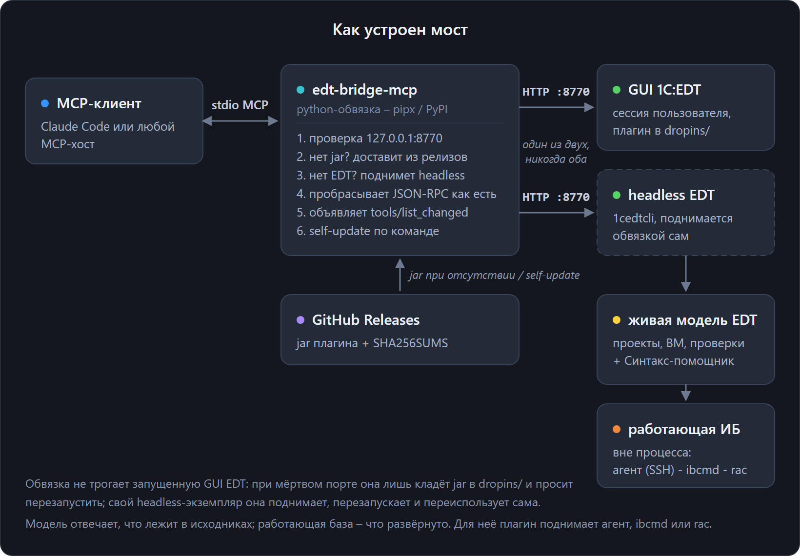
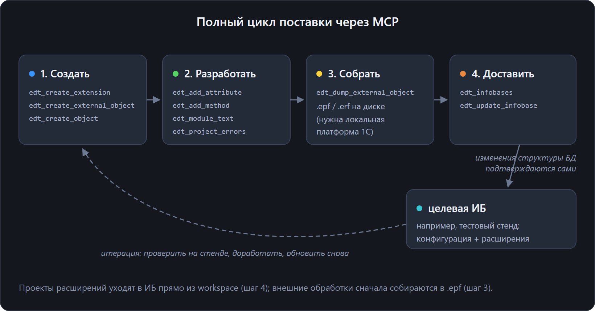

# EDT-Bridge


EDT-Bridge – плагин 1C:EDT, который предоставляет ИИ-агентам и другим инструментам доступ к
семантической модели среды по протоколу MCP. Для работы плагина нужна запущенная EDT с открытым
проектом, с интерфейсом или в режиме headless.

Инструменты предоставляют диагностики EDT, структуру и типы метаданных, семантические ссылки и
Синтакс-помощник платформы из поставки EDT. Они проверяют запросы по метаданным проекта,
создают и переименовывают объекты, выполняют сборку и поставку. Также доступны работа с
информационными базами и отладка. Операции выполняет штатный движок EDT.

> Сервер доступен только на localhost. Инструменты изменения модели требуют токен и по умолчанию
> возвращают план. Инструменты отладки также требуют токен.

[English](../../README.md) · **Русский**

**Документация: [docs.keyfire.ru/edt-bridge](https://docs.keyfire.ru/edt-bridge/ru/)**

Заметки о разработке и новости – в Telegram-канале [1С × ИИ: инженерный цех](https://t.me/ceh_1c_ai).



## Установка (рекомендуется: pipx)

Обвязка [**edt-bridge-mcp**](../../python/README.ru.md) работает как stdio MCP-сервер для клиента
и передает запросы в EDT. Если EDT не запущена, обвязка запускает ее в режиме headless. Если jar
плагина отсутствует в `dropins/` EDT, обвязка устанавливает его.

```bash
pipx install edt-bridge-mcp
```

Затем зарегистрировать обвязку в MCP-клиенте. В примере используется Claude Code, а `--workspace`
задает рабочую область EDT для автоматического запуска в режиме headless:

```bash
claude mcp add edt-bridge -- edt-bridge-mcp --workspace "D:\\путь\\к\\workspace-EDT"
```

Флаги обвязки, токен инструментов записи и `self-update` описаны в
[python/README.ru.md](../../python/README.ru.md). Если хотите запускать плагин сами, без обвязки,
смотрите [Установку вручную](#установка-вручную-без-обвязки) ниже.

<details>
<summary>Нет <code>pipx</code>?</summary>

`pipx` ставит Python-приложения CLI в изолированные окружения. Установить один раз:

```bash
python -m pip install --user pipx
python -m pipx ensurepath      # затем переоткрыть терминал
```

macOS: `brew install pipx && pipx ensurepath`. Подробнее: <https://pipx.pypa.io>.
</details>

### Настройки в самой EDT

Страница параметров плагина находится в разделе **Окно ▸ Параметры ▸ EDT-Bridge**. Здесь можно
указать токен для моста, работающего внутри EDT с интерфейсом:

| Параметр | Что это |
|----------|---------|
| **Токен для инструментов записи** | Общий секрет, который требует каждый инструмент записи. Пустой токен означает, что запись запрещена, а не что она открыта всем. Клиенту уходит то же значение под именем `EDT_BRIDGE_TOKEN`. |
| **Порт MCP-сервера** | По умолчанию 8770. **Вступает в силу после перезапуска EDT**, а до перезапуска работающий сервер держит прежний порт. |
| **Разрешить выполнение произвольного кода BSL при отладке** | По умолчанию выключено. Этот переключатель закрывает `edt_evaluate`, который исполняет код против живой информационной базы. Только тестовые стенды. |

Системные свойства `-Dedt.bridge.*` и переменные окружения `EDT_BRIDGE_*`, заданные при запуске,
имеют приоритет над сохраненными параметрами. Обвязка использует их для управления headless EDT.
Если токен указан при запуске, значение со страницы параметров не применяется.

## Инструменты

<!-- tools:start -->

Имена инструментов – `edt_*` в snake_case, параметры – camelCase: `projectName`, `fqn`, `queryText`.
Имя объекта пишется кириллицей, как в конфигурации, а префикс типа – по-английски:
`Catalog.Контрагенты`, `Document.ЗаказКлиента`. MCP-хост показывает агенту инструменты всех серверов одним списком. Префикс `edt_` указывает,
что инструмент относится к EDT. Например, `edt_rename` отличается от инструмента `rename` другого сервера.

Если вызов содержит необъявленный параметр, инструмент отклоняет его. В ответе указано близкое имя
(`deleteContents` → `deleteContent`) и список допустимых параметров.

Инструменты позволяют создавать и разрабатывать объекты, выполнять сборку, поставку и отладку
через MCP.



### Чтение

| Инструмент | Что возвращает |
|------------|----------------|
| `edt_projects` · `edt_project_errors` | Проекты рабочей области и замечания Eclipse и проверок EDT. `modelReady` показывает готовность BM-модели и производных данных; `complete=false` обозначает неполный снимок, который нельзя считать результатом успешной проверки. Фильтры: `fqn`, `modulePath`, `severity`; `countOnly` возвращает счетчики, а диагностику готовности – только при неполном результате или с `details=true`; `brief` – по строке на замечание. `modulePath` включает маркеры EDT, сопоставленные с файлами; несопоставленные маркеры отмечаются счетчиком и подсказкой. Фильтр формы исключает соседние формы. `stale` обозначает маркер старше исходника, `unsynchronized` – изменение на диске, еще не прочитанное средой. `refresh=true` перечитывает область и запускает сборку; `waitSeconds` задает ожидание валидации (1-600, по умолчанию 120). При таймауте возвращаются текущие маркеры с `refreshed.settled=false`. Проверка сгенерированного кода должна включать WARNING: часть неопределенных методов EDT относит к предупреждениям. |
| `edt_support_status` | Проверка разрешения EDT на прямое редактирование объекта (`projectName`, `objectFqn`). Возвращает `EDITABLE`, `READ_ONLY` или `UNKNOWN`; недоступная служба не означает разрешение на запись. Проверка не блокирует объект. |
| `edt_check_info` | Возвращает описание проверки, примеры неправильного и правильного кода и ссылки на стандарты разработки 1С на русском или английском языке. Инструмент дополняет `edt_project_errors`, который указывает сработавшую проверку. Поиск выполняется по идентификатору или заголовку проверки. Короткий код вида `SU68` разрешается в проверку, если в `projectName` назван проект, сообщивший о проблеме. |
| `edt_tool_help` | Полное описание и схема параметров одного инструмента, наборы, в которые он входит, и доступен ли он в действующем наборе. Неизвестное имя отклоняется с перечнем ближайших имен. За свои инструменты и инструменты плагинов отвечает обвязка. |
| `edt_property_reference` | Перечисляет свойства, которые инструмент записи может установить у одной цели – общего модуля, реквизита или элемента формы: тип каждого свойства, допустимые значения перечисления и текущее значение, а также инструмент, который их принимает. Для формы без `item` возвращает имена ее элементов. Перечень строит код проверки записи, поэтому свойства, которого у объекта нет, в перечне нет. |
| `edt_metadata_objects` · `edt_metadata_details` | Объекты метаданных верхнего уровня, при желании с фильтром по типу и по подстроке имени. Дальше – свойства одного объекта и его структура: реквизиты, табличные части, формы, команды, макеты, измерения, ресурсы, значения перечислений, и у каждого реквизита тип. Для общего реквизита возвращаются состав использования, autoUse и настройки разделения; для подписки на событие – типы источников, событие и обработчик. Для регламентного задания в `properties` возвращаются `use`, `methodName`, `predefined`, `key`, `restartCountOnFailure` и `restartIntervalOnFailure`, включая значения модели по умолчанию. Значения строковые; они описывают метаданные, а не текущее состояние планировщика. |
| `edt_find_references` · `edt_outgoing_calls` · `edt_outgoing_structures` | Возвращают входящие ссылки и исходящие вызовы. Ссылки на объект метаданных берутся из индекса EDT; параметр `method` позволяет найти места вызова `CommonModule.X.method` в BSL. Для исходящих вызовов указываются вызываемые методы модуля, метода или формы, число мест вызова и признак слоя ExtAPI. Также доступны распознанные ключи верхнего уровня `Структуры`, переданной каждому квалифицированному исходящему вызову. Поиск методов также находит литеральные вызовы менеджеров вида `Справочники.Товары.Метод(...)`; `moduleType` не сужает этот поиск. Режим метаданных также возвращает `queryReferences` из запросов динамических списков и наборов СКД. Полноту отдельного поиска показывают `queryCoverageComplete` и ошибки. Режим метода ищет места вызова в BSL. |
| `edt_module_text` · `edt_go_to_definition` · `edt_symbol_info` | Возвращают текст модуля BSL или одного метода со списком процедур и функций и их сигнатурами; модуль задается по FQN или modulePath. Также возвращают определение символа в позиции, включая вид, имя, объект-владелец и расположение, либо элемент в позиции и вычисленные типы значения выражения. |
| `edt_search_modules` | Полнотекстовый поиск по модулям BSL проекта, подстрокой или регулярным выражением, с необязательным фильтром пути. Чтение идет через буферы файлов Eclipse, поэтому модуль, открытый в редакторе, ищется в текущем виде, вместе с несохраненными правками. `edt_find_references` отвечает на вопрос "кто вызывает этот метод", а этот – на вопрос "где встречается такой текст". Регулярные выражения используют классы символов и сравнение регистра Unicode. Тексты в `Form.form` и `Template.dcs` в поиск по BSL не входят. |
| `edt_search_queries` | Ищет текст или регулярное выражение с Unicode в запросах динамических списков `Form.form` и наборов данных `Template.dcs`. Возвращает путь, форму/реквизит либо макет/набор, строку запроса и строку XML-поля. Ошибки разбора и усечение дают `complete=false`. |
| `edt_validate_query` | Проверяет запрос 1С по живым метаданным проекта: синтаксис и семантику, поэтому несуществующие таблицы и поля и ошибки типов возвращаются с позициями. Принимает текст запроса либо адрес модуля (`modulePath`, при желании один `method`). Для модуля инструмент извлекает из текущего текста литералы запросов с обрамлением `\|` и проверяет каждый. Пакет проверяется и как целое, чего EDT не делает. Запрос, читающий временную таблицу, которую ни один предыдущий запрос не создал (`ПОМЕСТИТЬ`) или которую предыдущий запрос уничтожил, делает текст невалидным. Для литерала из модуля это сообщение `INFO`: таблицу может дать общий менеджер временных таблиц или другой литерал. |
| `edt_form_structure` · `edt_form_render` · `edt_picture_export` | Возвращают структуру управляемой формы, ее изображение и содержимое изображения конфигурации. Структура включает дерево элементов: поля, группы, таблицы, кнопки и декорации. Для элементов указываются привязки данных, статические visible/enabled/readOnly, обработчики, свойства полей ввода, связь команды с кнопкой и условное оформление. Также возвращаются реквизиты, команды, параметры и обработчики формы. Форма отрисовывается в PNG штатным offscreen-рендером EDT с выбором варианта интерфейса и темы. Для CommonPicture возвращается содержимое Picture.zip. |
| `edt_read_html_template` | Точный UTF-8 текст и `sourceHash` существующей языковой версии общего или вложенного HTML-макета. Нужны явные `templateFqn` и `language`; возвращает доступные языки и разрешенный моделью путь. |
| `edt_form_identifiers` | Проверка визуальных ID во всей модели формы, включая подсказки, меню и командные панели. Возвращает пути повторных вхождений и хеш без выдачи ID. У реквизитов и команд отдельные пространства идентификаторов. |
| `edt_platform_help` | Выполняет поиск по имени или возвращает текст страницы Синтакс-помощника платформы 1С:Предприятие из поставки EDT. Справка на русском и английском языках содержит объекты, методы, свойства, события и сигнатуры методов. |

Запросы динамических списков сначала разбираются языком Ql из EDT. При синтаксической ошибке
разбор повторяется языком QlDcs, который поддерживает расширения компоновки данных
`{ГДЕ ...}` и `{ЛЕВОЕ СОЕДИНЕНИЕ ...}`. Если разобрать запрос не удалось, ошибка попадает
в `queryFailures`, а `queryCoverageComplete` остается ложным. Для текстового поиска по таким
полям запросов используйте `edt_search_queries`.

#### Диагностика проекта и среды

`edt_projects` возвращает состояние модели в поле `diagnostics` каждого проекта, для которого
доступны эти сведения. В `pendingReasons` перечислены условия ожидания, например блокировка
модели или вычисление производных данных. В `derivedData` видны этап обработки и сведения EDT
об активных сегментах. `backgroundJobs` относится ко всей рабочей области.

`edt_project_errors` возвращает `diagnostics.pendingReasons`, фоновые работы, состояние
валидации и наблюдаемое число замечаний. Проверка объекта может завершиться, пока фоновые
работы еще выполняются. Чтобы прочитать текущее состояние, вызовите инструмент снова без
`refresh` и `baseline`. Полноту результата определяет `complete`. После обновления учитывайте
также `refreshed.settled`.

Время наблюдения указано в миллисекундах от начала эпохи Unix. `firstObservedAt` отмечает
первое наблюдение в сохраненной истории, а `unchangedSince` – первое наблюдение текущего
значения. При первом чтении `lastChangeKnown=false`. После обнаружения другого значения
`lastChangeObservedAt` указывает время, когда мост заметил разницу. История ограничена текущим
процессом. Для недоступных показателей EDT возвращаются `available=false` и `unavailableReason`.

`GET /status` возвращает `resources` работающего моста. В `jvm` указаны использование,
выделенная память и доступный предел для кучи и памяти вне кучи, а также число и длительность
сборок мусора по каждому сборщику JVM. На Linux раздел `container` показывает использование
и пределы памяти, события, давление памяти, квоту и счетчики ЦП текущей группы cgroup v2,
если они доступны для чтения. Снимок собирается чтением JVM и cgroup. Для недоступных
показателей указана причина. `processStartedAt` хранит время запуска текущего процесса.
`previousExitCause` имеет значение `unknown`.

#### Предпросмотр управляемой формы

`edt_form_render` использует штатный отрисовщик EDT для `TAXI` и `VERSION8_5`. Чтобы включить
отрисовку и получение изображения из буфера, передайте JVM параметры
`-DnativeFormLayoutRender=true` и `-DnativeFormBufferedLayoutRender=true`. Для headless EDT
с GTK также нужен работающий графический сеанс, например X-сервер Xvfb.
При передаче дополнительных параметров JVM графической программе запуска `1cedt`
используйте `--launcher.appendVmargs`, чтобы сохранить параметры из файла INI поставки.

Получение изображения подтверждают `ok=true`, `pngPath` и положительное значение `fileBytes`.
В `diagnostics` могут быть указаны платформа SWT, состояние графического сеанса, настройки
отрисовщика и этап отрисовки. Если EDT не вернула изображение, проверьте `.metadata/.log`
в рабочей области EDT или откройте предпросмотр формы в графическом режиме EDT. При аварии
нативного процесса в рабочем каталоге EDT также может появиться `hs_err_pid*.log`.

На EDT 2026.2.2 с платформой 8.5.1.1529 headless EDT под Windows с SWT win32 вернула PNG для
обоих вариантов. В проверенном профиле Linux с GTK и Xvfb графическая и headless EDT дошли
до нативного процесса SCom, который завершился с ошибкой при инициализации. В этом профиле
предпросмотр не получен. Команда `edt-bridge-mcp test-form` запускает основную форму собранного
EPF или ERF либо форму документа/справочника по внутренней навигационной ссылке в явно выбранной
файловой тестовой базе. JSON-сценарии проверяют представления полей, содержимое табличного
документа и число сообщений; `reopen` проверяет ту же цель в новой сессии. Подготовка окружения,
примеры и ограничения описаны в [руководстве по проверке форм](https://docs.keyfire.ru/edt-bridge/ru/native-forms/).

### Запись

Инструменты записи разрешают цель через EDT. Операции с метаданными выгружают модель,
замена исходного текста записывает разрешенный файл рабочей области. Для записи нужен токен.
По умолчанию `apply=false` возвращает план.

`edt_delete_object` разделяет ссылки из индекса EDT и лексические кандидаты в `referenceAudit`.
`scanComplete` относится к указанной области файлов; `complete=false` явно ограничивает семантическое покрытие.
Перед удалением с `force` проверьте `countIsLowerBound`, ошибки и образцы. После применения
`deletionConfirmed` подтверждает отсутствие цели в живой BM-модели. `remainingPossibleReferences`
и `retainedFormControls` показывают оставшиеся обращения и элементы с очищенной привязкой;
ответ указывает границы ожидания экспорта и проверки после операции.

| Инструмент записи | Что делает |
|-------------------|------------|
| `edt_create_object` · `edt_delete_object` | Создает объект верхнего уровня – справочник, документ, перечисление, регистр сведений и прочие – через фабрику EDT и инициализатор типа и регистрирует его в Configuration. Удаление выполняется штатным рефакторингом EDT и требует `force`. Предпросмотр показывает индексированные ссылки и возможные обращения в BSL, текстах запросов и привязках форм. Такие обращения могут остаться после удаления; ответ не обещает полный каскад. |
| `edt_add_attribute` · `edt_modify_attribute` · `edt_remove_attribute` | Добавляет или меняет реквизит, ресурс или измерение регистра (`kind`, по умолчанию `attribute`). При добавлении проверяет имя по всем трем спискам полей. Меняет тип, русский синоним и комментарий. `edt_remove_attribute` удаляет реквизиты; ресурсы и измерения удаляются через `edt_delete_object` с FQN члена. Параметр `use=ForFolder\|ForItem\|ForFolderAndItem` задает применение реквизита иерархического объекта; `multiLine` разрешает многострочный ввод. Неприменимые и неверные параметры отклоняются до записи. Изменение сохраняет UUID реквизита; `properties` содержит фактические значения. |
| `edt_rename` | Переименовывает метод, объект метаданных или член через штатный движок EDT. Предпросмотр возвращает известные затрагиваемые файлы и признаки полноты списка и счетчиков. Нужен `force`: переименование ломает все, что построено на старом имени. |
| `edt_add_method` · `edt_delete_method` | Добавляет и удаляет процедуру или функцию в BSL модуля, обе операции идут по модели. Вставка отказывает, если результат перестает разбираться. Вырезание забирает прилегающий документирующий комментарий, а план возвращает точный текст, который уйдет, – поэтому и нужен `force`. Модуль адресуется по FQN, включая `HTTPService.X` и `WebService.X`. |
| `edt_add_route` | Добавляет в `HTTPService` маршрут: шаблон URL и один HTTP-метод. Инструмент генерирует `uuid` шаблона и его метода, разрешает перечисление `httpMethod` и с параметром `createHandler` вставляет в модуль сервиса заготовку `Функция <handler>(Запрос)`. |
| `edt_add_form` | Добавляет объекту метаданных управляемую форму штатным генератором EDT – тем же, что стоит за мастером "Новая форма". Генератор создает форму, ее элементы и модуль в XML. При `defaultForm=true` вид формы определяет основное свойство, например `defaultObjectForm` или `defaultFolderForm` справочника. Неподдерживаемое назначение отклоняется до создания. `defaultForm` подтверждает выполненное назначение, `defaultFormProperty` указывает свойство. |
| `edt_add_form_attribute` · `edt_modify_form_attribute` · `edt_remove_form_attribute` | Добавляет, меняет и удаляет реквизит формы, а с параметром `columnOf` – колонку реквизита типа ТаблицаЗначений. Идентификаторы выдает служба идентификаторов формы. Кроме грамматики типов метаданных принимаются платформенные типы, допустимые у формы (`ТаблицаЗначений`, `СписокЗначений` и другие), и объектные типы `ВнешняяОбработкаОбъект.X` и `СправочникОбъект.X` – которые используются для основного реквизита. Удаление перечисляет связанные элементы и требует `force`. |
| `edt_add_form_command` · `edt_modify_form_command` · `edt_remove_form_command` | Добавляет, меняет и удаляет команду формы. При добавлении можно заодно записать в модуль формы заготовку процедуры-обработчика, а если модуля не было – создать его. Удаление перечисляет связанные кнопки и требует `force`. |
| `edt_add_form_handler` | Регистрирует обработчик события формы или ее элемента. Инструмент создает запись `handlers` в `Form.form`. Без нее платформа не вызывает процедуру, но валидация не сообщает об ошибке. Список допустимых событий берется из EDT; при неверном имени возвращается ошибка с этим списком. По запросу инструмент создает заготовку обработчика с сигнатурой события и директивой для его сред выполнения. |
| `edt_add_form_item` · `edt_modify_form_item` · `edt_remove_form_item` | Добавляет, меняет и удаляет визуальные элементы формы: поле, таблицу, кнопку, группу, декорацию. Для работы используется штатный `IFormItemManagementService`, который вызывает редактор форм. Таблица, связанная с реквизитом типа ТаблицаЗначений, получает колонки автоматически. Заданный таблице `titleRu` остается у таблицы, а сгенерированные колонки сохраняют штатный заголовок EDT. Параметр `newName` переименовывает элемент в модели формы, сохраняя имена процедур-обработчиков. Удаление включает все вложенные элементы и требует `force`. |
| `edt_adopt_object` | Заимствует объект базовой конфигурации в проект расширения штатным `IModelObjectAdopter`. Пока это не сделано, расширение не может перехватить у объекта ничего; этим же шагом достраивается `edt_create_extension`. |
| `edt_import_project` | Регистрирует в рабочей области каталог проекта, который уже есть на диске: "Импорт существующего проекта" без диалога. Расширение в режиме изменения и контроля сверяется с базовым проектом на целевом релизе, а тот лежит в другом рабочем дереве. На диске ничего не переписывается, а свое имя позволяет держать рядом две рабочие копии одного репозитория. Уже зарегистрированный закрытый проект открывается без повторного импорта, сохраняя настройки и связи с базами. Повторный вызов для открытого проекта ничего не меняет. |
| `edt_applications` | Список штатных приложений открытого проекта (`action=list`). Действие `associate` связывает проект с зарегистрированной базой по точному имени или UUID и использует существующее приложение. База не обновляется. Действие `start` запускает тонкий клиент приложения информационной базы, `stop` использует его id из списка; по умолчанию возвращают план, для записи нужен токен. Остановка ограничена процессом, дескриптор которого вернулся этому мосту. Если процесс еще завершается, повторное чтение `bridgeSession` через `list` подтверждает завершение. |
| `edt_modify_object` · `edt_update_subsystem` | Меняет флаги выполнения и повторное использование результатов общего модуля либо добавляет/удаляет существующие объекты из состава подсистемы. Весь запрос проверяется до записи; по умолчанию возвращается план. Удаление из состава дополнительно требует `force=true`. `extendModule=true` разрешает расширение заимствованного общего модуля. |
| `edt_create_extension` · `edt_create_external_object` | Создают проект расширения конфигурации или внешнего объекта. Расширение использует `IExtensionProjectManager`: корневая Configuration заимствуется из базовой конфигурации, как в мастере EDT; задаются префикс имен, назначение и синоним. Параметр `kind` инструмента `edt_create_external_object` принимает `processor` (по умолчанию) или `report`; при необходимости указать `baseProjectName`. Dry-run возвращает тип объекта и FQN, apply создает проект через `IExternalObjectProjectManager`. Добавить управляемую форму и собрать `.epf` или `.erf` через `edt_dump_external_object`. |
| `edt_clean_project` · `edt_delete_project` | Очищают результаты сборки или удаляют проект. Очистка программно вызывает функцию "Очистить" EDT, возвращает число замечаний до и после и ожидает стабилизации счетчика, чтобы проверки выполнились заново. Для одного модуля, измененного на диске, можно использовать `edt_project_errors` с `refresh=true`. Удаление выполняется средствами рабочей области Eclipse и требует `force`, поскольку отменить его нельзя. |
| `edt_build_extension` · `edt_dump_external_object` | Собирает бинарники: `.cfe` из проекта расширения, `.epf` или `.erf` из внешней обработки или отчета. Оба инструмента могут использовать полную установку платформы, если EDT не находит толстый клиент. Тогда модель выгружается в XML конфигуратора прямо в процессе, а файл собирается полной установкой 1С с диска во временной базе, которая потом удаляется. `logPath` сохраняет журнал сборки платформы рядом с артефактом. При отказе штатного дампера используется дисковый маршрут; `route` задает маршрут явно: `edt` или `disk`. Если отказ отключил автогенерацию выгрузок, она восстанавливается. |
| `edt_replace_html_template` | Заменяет полный точный текст существующей языковой версии HTML-макета. Предпросмотр возвращает старый и новый текст и хеши. Для записи нужны `expectedHash`, `force=true`, `apply=true` и токен. Несохраненные редакторы, измененная карта языков, устаревшие ресурсы, запрет записи и некорректный UTF-8 дают отказ. Другие языки сохраняются. Если проект занят другой операцией EDT, например обновлением базы, которое ждет ответа на вопрос, запись не выполняется и ответ содержит `busy=true`; вызов следует повторить после завершения этой операции. |
| `edt_add_template` | Создает макет у отчета, внешнего отчета, обработки или другого объекта: схему компоновки данных с пустой схемой или, с `templateType=SpreadsheetDocument`, пустой макет печатной формы; `setMainSchema` назначает его основной схемой отчета, и клиент открывает отчет общей формой отчета конфигурации. По умолчанию предпросмотр, для записи нужен токен. |
| `edt_read_dcs` | Читает точный текст макета схемы компоновки данных - XML схемы в формате конфигуратора - с путем и `sourceHash`. |
| `edt_read_spreadsheet` | Читает табличный макет – макет печатной формы – как ширины колонок и именованные области строк из ячеек: `text`, `parameter` или `template`, с `bold`, `fontSize`, `align`, `border`, `colspan` и `wrap`. Ответ служит входом `edt_write_spreadsheet`; `unsupported` называет то, что в файле есть, но в описание не входит, например картинки и цвета. |
| `edt_write_spreadsheet` | Заменяет весь макет переданными колонками и областями. Макет с возможностями, которых нет в описании, отклоняется без `dropUnsupported=true`. Предпросмотр возвращает изменение и `sourceHash`; для записи нужны он же в `expectedHash` и токен. |
| `edt_spreadsheet_render` | Рисует макет в PNG так, как его показывает редактор макетов: ширины колонок, текст, `<Параметр>` для параметра, жирность, выравнивание, рамки, объединения и имена областей. Платформа и экран не нужны. |
| `edt_replace_dcs` | Заменяет полный текст схемы; EDT перечитывает схему из файла. Предпросмотр возвращает старый и новый текст и хеши; для записи нужны `expectedHash`, `force=true` и токен. Проверка EDT не сверяет XML схемы: результат проверяет сборка `edt_dump_external_object`. |
| `edt_modify_dcs` | Добавляет поля в набор данных и параметры в схему без передачи всего XML: `edits` из `addField` (`dataSet`, `dataPath`, `titleRu`) и `addParameter` (`name`, `titleRu`, `type`: String(N), Number(D,F), Date, DateTime, Boolean, StandardPeriod). Остальная часть файла не меняется, повтор отклоняется. Для записи нужен `sourceHash` предпросмотра. Проверка EDT не сверяет XML схемы: результат проверяет сборка `edt_dump_external_object`. |
| `edt_form_identifiers` | С явным `itemPaths` показывает план перенумерации выбранных повторных вхождений. Для записи нужны текущий `expectedHash` и токен. Остальные ID, данные объектов и порядок сохраняются. Зарезервированные ID, неоднозначные числовые ссылки и открытый редактор этой формы блокируют исправление. |
| `edt_apply_fix` | Применяет штатное исправление EDT к одному маркеру проверки (`checkId` в том виде, в каком его выдает `edt_project_errors`, сужение – `fqn` и `line`). Предпросмотр перечисляет варианты; применение выполняет вариант, повторяет проверку и возвращает измененные строки и `remaining`. `hasFix=false` означает, что у проверки нет штатного исправления. Исправлению модуля нужна клиентская EDT: EDT применяет его через редактор модуля, и мост в headless-режиме отказывает с `requiresWorkbench=true`. В клиентской EDT мост сохраняет этот редактор (`editorSaved`) и отказывает, если в редакторе уже есть несохраненные правки. |
| `edt_replace_method` | Заменяет один существующий метод с разбором через EDT. Dry-run возвращает точные oldText/newText и sourceHash всего модуля. Для apply нужны этот хеш и force=true; устаревший источник, несохраненный редактор и некорректный фрагмент дают отказ. Имя и вид метода сохраняются, окружающий код не меняется. |
| `edt_replace_module_fragment` | Заменяет точный фрагмент модуля вне методов: директивы компиляции, переменные модуля, области, блок `#Если`. Фрагмент должен встречаться один раз; `edits` применяет несколько фрагментов вместе, и область открывается и закрывается одним вызовом. Результат должен разбираться. Предпросмотр возвращает `sourceHash`, для записи он нужен в `expectedHash` вместе с токеном. |
| `edt_move_method` | Переносит метод внутри модуля с точным сохранением текста, документирующего комментария и директив. Принимает путь вложенной области и соседний метод, проверяет промежуточный и итоговый модуль парсером EDT. Для записи нужны `apply=true, force=true`. |
| `edt_move_form_item` | Переносит существующий элемент формы по индексу или соседу с сохранением объекта, id, вложенных элементов, свойств и событий. Отклоняет циклы и переносы, требующие преобразовать вид элемента или привязку к данным. |
| `edt_import_external_object` | Импортирует существующую `.epf` или `.erf` в новый проект EDT, при необходимости с `baseProjectName`. Распаковывает XML через EDT или полную установку платформы и передает штатному импортеру EDT. Сохраняет исходный файл; при ошибке удаляет собственный незавершенный проект. |


#### HTML, ID формы и проверка метаданных

Перед заменой прочитать нужную языковую версию HTML. Хеш охватывает точные UTF-8 байты:
BOM представлен начальным символом U+FEFF в `text`. Для сохранения BOM включить этот символ
в новый текст. Переводы строк и конечные пробелы записываются как переданы. Пустая строка
намеренно очищает языковую версию; отсутствие текста дает отказ. При совпадении текста
запись не выполняется. Редакторы затронутого макета нужно сохранить.

Для повторных ID сначала выполнить проверку, затем выбрать пути из `audit.items`.
Оставить хотя бы одно вхождение каждого повторного ID без изменения. Проверить план
с этими `itemPaths`, закрыть редактор этой формы и применить с текущим `expectedHash`.
Инструмент сбрасывает штатные кеши генераторов; такой же сброс выполняется перед добавлением
элементов, реквизитов и команд. `exportAccepted` подтверждает прием запроса на выгрузку.
Для проверки сохранения перечитать `Form.form` и повторить валидацию.
Проверка ID и ее предпросмотр не требуют токена записи.

Связь приложения создается в текущем контексте EDT, включая ветку Git.
`associationVerified` подтверждает сохраненную связь, `verified` – штатное приложение.
Повторный вызов использует это приложение и не обновляет базу.

При точном `fqn` или `modulePath` вызов `edt_project_errors` с `refresh=true` явно запрашивает
применимые проверки одного BM-объекта. Неразрешенный или противоречивый адрес не расширяет
этот запрос до всего проекта. `validationRequested` и `validationCompleted` отражают запрос
и завершение проверки. Одни счетчики или непроверенная часть ограниченной выборки
не подтверждают свежесть маркеров. При полной очистке проверять `stage`, `completedStages`,
время и сведения об отмене и статусе. `ok=false` с `applied=true` обозначает последующий
отказ после изменения состояния сборки. Снимок заданий сам по себе не доказывает причину отмены.

#### Замена существующего метода BSL

`edt_replace_method` меняет тело, параметры, признак экспорта, прилегающие комментарии
и директивы метода одной операцией. Имя и вид метода должны остаться прежними.
Для переименования с изменением вызовов используйте `edt_rename`.

1. Прочитать код через `edt_module_text`. В полный новый текст включить описание метода,
   директивы компиляции и комментарий после завершающего ключевого слова. Чтение одного
   метода может пропускать эти части; `oldText` в dry-run показывает полный диапазон замены.
2. Проверить `edt_support_status` для объекта и сохранить открытый редактор модуля.
3. Вызвать `edt_replace_method` без `apply`. Сравнить `oldText` и `newText`, сохранить
   `sourceHash`. Новый фрагмент содержит ровно один метод без окружающих областей,
   блоков препроцессора, переменных и операторов уровня модуля.
4. Передать тот же новый текст с `apply=true`, `force=true` и `expectedHash`, равным
   полученному `sourceHash`. После любого изменения модуля повторить dry-run.
5. Перечитать сохраненный код и вызвать `edt_project_errors`. Разбор проверяет синтаксис;
   операция не исправляет вызовы после изменения параметров и не подтверждает работу кода.

Предпросмотр:

```json
{
  "projectName": "Demo",
  "fqn": "CommonModule.Api",
  "methodName": "Calculate",
  "methodText": "Function Calculate(Value) Export\n    Return Value + 1;\nEndFunction"
}
```

Запись с хешем из этого предпросмотра:

```json
{
  "projectName": "Demo",
  "fqn": "CommonModule.Api",
  "methodName": "Calculate",
  "methodText": "Function Calculate(Value) Export\n    Return Value + 1;\nEndFunction",
  "expectedHash": "<sourceHash из dry-run>",
  "apply": true,
  "force": true
}
```

`oldText` и `newText` включают прилегающие комментарии и директивы: если их не передать
в `methodText`, они будут удалены. `sourceHash` охватывает весь модуль UTF-8 вместе с BOM;
`resultHash` соответствует предложенному или сохраненному результату. Новый фрагмент
получает окончания строк исходного файла. Остальной текст и BOM сохраняются. Некорректные
UTF-8 и Unicode дают отказ. При совпадении текста возвращается `unchanged=true` без записи.
Отсутствующий или неоднозначный метод, несохраненный редактор и ошибка разбора исходного
модуля также блокируют запись. Операция не создает отсутствующий модуль.

#### Поля регистров

`edt_add_attribute` и `edt_modify_attribute` принимают `kind`: `attribute` (по умолчанию),
`resource` или `dimension`. Для ресурса или измерения владелец должен поддерживать
соответствующий список полей. Поддерживаются регистры сведений, накопления, бухгалтерии
и расчета. Вызовы без `kind` по-прежнему адресуют реквизит.

При добавлении имя проверяется без учета регистра среди `attributes`, `resources`
и `dimensions` владельца, повторно – внутри транзакции записи. При совпадении ответ
содержит `nameAvailable=false` и точные `conflictingFqns`. Предпросмотр ничего не записывает.

Для ресурсов регистров накопления, бухгалтерии и расчета укажите один явный тип
`Число`, например `Число(15,2)`. Нечисловой, составной, ссылочный или определяемый тип
для такого ресурса отклоняется до записи. У ресурсов регистра сведений сохраняется
общая грамматика типов. Явный `kind` выбирает этот список, даже если в старой конфигурации
есть одноименное поле другого вида; дубли внутри выбранного списка дают отказ.

Пример предпросмотра добавления ресурса:

```json
{
  "projectName": "Demo",
  "ownerFqn": "InformationRegister.Versions",
  "kind": "resource",
  "name": "Version",
  "type": "Строка(20)"
}
```

Для изменения поля вызовите `edt_modify_attribute` с теми же владельцем, именем и видом
и хотя бы одним из `newType`, `newSynonymRu` или `newComment`. Пустой синоним или комментарий
очищает значение; отсутствие параметра сохраняет его. Смена типа возвращает предупреждение
о совместимости данных и кода. Обе операции требуют `apply=true` для записи. Ответ различает
фиксацию в модели и прием запроса экспорта; прием запроса не подтверждает завершение сериализации.

`edt_remove_attribute` по-прежнему удаляет только реквизиты. Если изменение или удаление
адресует ресурс или измерение как реквизит, ответ указывает фактический FQN члена
и подсказывает `kind`, `edt_delete_object` и `edt_rename`. Для удаления или переименования
таких полей используйте последние два инструмента с `targetFqn`, например
`InformationRegister.Versions.Resource.Version`.

### Информационные базы, кластер и платформа

Эти инструменты обращаются к работающей информационной базе. Они используют четыре разных способа
подключения, которые указаны в столбце **Через**.

- **штатная синхронизация EDT** – то, чем пользуется сама среда. EDT открывает собственное соединение с базой. Передать учетные данные вне интерфейса нельзя,
  поэтому синхронизация недоступна для базы с аутентификацией пользователей.
- **`ibcmd`** идет прямо к базе данных, путем или координатами СУБД, поэтому кластерной базе доступ
  к кластеру не нужен. Режим `extension` не принимает учетные данные 1С.
- **агент конфигуратора** – это конфигуратор, запущенный с `/AgentMode`. Он принимает команды по SSH
  и проходит аутентификацию как пользователь базы. Это позволяет обращаться к базам, недоступным
  двум другим способам. Мост использует один агент на каждую базу и сохраняет его между вызовами.
- **`rac`** обращается к кластеру и управляет его сеансами. Ни агент, ни `ibcmd` их не видят.

Инструментам, которые изменяют базу, требуется токен. По умолчанию они возвращают план.

| Инструмент | Через | Что делает |
|------------|-------|------------|
| `edt_infobases` · `edt_platform_installations` | EDT | С чем работает платформенная сторона. Зарегистрированные в EDT информационные базы с именем, uuid и строкой соединения, а к ним привязки открытых проектов. Дальше – установки 1С:Предприятие, из которых EDT выбирает при выгрузке `.epf` и `.erf` и при создании базы: каждая разрешена до конкретной установки с толстым клиентом, плюс полные установки, найденные на диске. |
| `edt_platform_build_readiness` | установка на диске | Запускает Конфигуратор на временной файловой базе для проверки пакетного режима и доступа к лицензии. Требует токен записи. |
| `edt_designer_agent` | агент | Жизненный цикл агентов конфигуратора, которыми управляет мост: список, запуск, остановка, уборка. Агент – это конфигуратор в режиме `/AgentMode` с открытым сеансом базы, проходящий аутентификацию как пользователь базы; так мост и добирается до базы, недоступной остальным транспортам. Агент запускается по требованию и продолжает работать между вызовами. Остановка освобождает сеанс на сервере. Простояв дольше `EDT_BRIDGE_AGENT_IDLE_MINUTES`, агент останавливается сам, потому что занимает клиентскую лицензию и сеанс конфигуратора; по умолчанию это 30 минут, а `off` отключает остановку по времени простоя. После аварийного завершения агента может остаться сеанс с блокировкой конфигурирования базы. Такой сеанс удаляется перед каждым запуском, при `stop` для базы, агент которой завершился с ошибкой, и по запросу `action=sweep`. Принадлежность определяется по записи агента, а не по хосту и пользователю сеанса. `list` также возвращает `edtSessions` – сеансы конфигуратора, которые EDT держит для своих баз: база, связанные проекты, pid и состояние (`live`, `dead` или `external` для агента, запущенного не EDT), – и `otherConfigurators`, процессы толстого клиента, не принадлежащие ни мосту, ни EDT. `action=stop-edt` закрывает сеанс EDT для одной зарегистрированной базы средствами EDT: агент, запущенный EDT, завершается, от чужого агента EDT только отключается. |
| `edt_infobase_config_state` | агент | Проверяет, применена ли конфигурация базы данных, которую исполняют сеансы, или ожидается обновление. Обновление запускается, но его подтверждение отклоняется, поэтому изменения не применяются. Для ожидающего обновления возвращается полный список изменений структуры. Вызов идет через агент конфигуратора, поэтому доступна серверная база с аутентификацией пользователей. |
| `edt_update_database_config` | агент | Применяет конфигурацию базы данных. Это шаг, после которого работающие сеансы начинают исполнять ту конфигурацию, которую хранит база. Загрузка проекта в базу этого не делает: до применения каждый сеанс исполняет прежний код, и так выглядит только что добавленный маршрут HTTP-сервиса, отвечающий 404. По умолчанию возвращает план. `sessionTermination=force` завершает удерживающие базу сеансы, когда нужна монопольная блокировка. |
| `edt_update_infobase` | EDT · агент | Обновляет конфигурацию базы из проекта EDT. По умолчанию используется синхронизация EDT: изменения структуры базы данных подтверждаются автоматически, конфликт прерывает обновление, а база с пользователями не поддерживается. При `transport=agent` проект выгружается в XML конфигуратора и загружается через агент конфигуратора. Этот способ поддерживает серверную базу с пользователями; конфигурация базы данных применяется, если не указано `updateDatabaseConfig=false`. Если сохраненная запись о загрузке соответствует состоянию базы, загружаются только измененные файлы. Условия и параметр `fullLoad` описаны в разделе [Загрузка измененных файлов](#загрузка-измененных-файлов). |
| `edt_create_infobase` · `edt_register_platform` | EDT · установка с диска | Создает пустую файловую базу и регистрирует ее в списке EDT, а если под нужную версию EDT ничего не нашла, берет полную установку с диска. Второй инструмент регистрирует полную установку в EDT, чтобы ею мог пользоваться ее собственный движок. |
| `edt_register_infobase` | EDT | Регистрирует существующую серверную базу по `name`, `connect="Srvr=server;Ref=base;"`, `version` и необязательному `user`. Использует EDT, обновляет ее список и считывает UUID без перезапуска среды. Отклоняет дубликаты имен/адресов и учетные данные в строке; серверную базу не создает и не изменяет. |
| `edt_extension_properties` | агент · ibcmd | Читает и задает то, как расширение зарегистрировано в базе: безопасный режим, защита от опасных действий, активность, область действия. Ни сборка `.cfe`, ни обновление из EDT этого не решают, а только что зарегистрированное расширение получает безопасный режим и защиту включенными. Расширение, которое меняет методы базовой конфигурации, под ними не работает. Передайте проект расширения, чтобы проверить, препятствуют ли эти настройки его работе. По имени из EDT вызов идет через агента, которому доступна серверная база с пользователями; по явным координатам СУБД – через `ibcmd`, которому она недоступна. |
| `edt_delete_extension` | агент | Снимает расширение с информационной базы. План содержит текущие свойства расширения; при неверном имени возвращается ошибка. Кроме apply нужен `force`: конфигурация расширения хранится в базе, и восстановить ее этим инструментом нельзя. |
| `edt_infobase_sessions` | rac | Сеансы кластера 1С через `rac`: перечислить по базе или по виду приложения и завершить. Агент и `ibcmd` не управляют сеансами, поскольку те находятся в менеджере кластера. Инструмент помогает освободить базу для конфигурирования. Принудительно завершенный сеанс конфигуратора может сохранять блокировку конфигурации и виден здесь как сеанс `Designer`. Завершение по умолчанию возвращает план и требует force. |
| `edt_infobase_maintenance` | rac | Управляет окном обслуживания при обновлении базы. `begin` устанавливает `scheduled-jobs-deny` и, по запросу, `sessions-deny` с кодом доступа. После завершения сеансов возвращается "clear to update". `end` снимает оба флага, включая `sessions-deny`, установленный другим вызовом `begin`, и сообщает, если флаг остался установленным. `status` возвращает состояние. В работающей базе сеансы BackgroundJob пересоздаются каждую минуту, поэтому перед их завершением требуется запрет. Нужен администратор базы, по умолчанию возвращается план. |
| `edt_infobase_dump` | ibcmd | Выгружает информационную базу в `.dt` через `ibcmd`. Такую резервную копию можно создать перед применением конфигурации к базе данных. База адресуется путем или координатами СУБД, перезаписывать существующий файл инструмент отказывается, по умолчанию возвращает план. В самой базе ничего не меняется, но выгрузка читает все ее данные, поэтому нужен токен. |

#### Проверка готовности платформы к сборке

`edt_platform_installations` перечисляет полные установки, доступные в EDT и на диске. Чтобы
проверить запуск платформы, вызовите `edt_platform_build_readiness` с настроенным токеном
записи. Параметр `platformVersion` выбирает точную сборку по четырем компонентам версии или
новейшую полную установку указанной линии. Если параметр опущен, проверяется новейшая полная
установка. `timeoutSeconds` задает предел ожидания каждого процесса (1–120 секунд, по умолчанию
30).

Инструмент создает файловую базу во временном каталоге и выполняет для нее `1cv8 DESIGNER /DumpCfg`.
Запуск использует установку платформы и доступ к лицензии в среде моста. Результат удаления
временных файлов указан в `cleanup`. Поле `installation` различает отсутствие полной установки
(`platformNotFound`) и отсутствие запрошенной версии (`incompatibleVersion`). Этапы
`createInfobase` и `designer` возвращают состояние, в том числе отказ лицензии
(`licenseRefused`), сбой запуска (`launchFailed`), превышение времени ожидания (`timedOut`) или
пропуск этапа (`notChecked`). Имя программы и код завершения указываются, если они доступны.
Успех подтверждает, что выбранный Конфигуратор смог выгрузить пустую конфигурацию в этой среде.

Ошибка команды платформы содержит имя программы, операцию и код, если процесс завершился.
Аргументы команды в названии операции опускаются.

#### Загрузка измененных файлов

При вызове `edt_update_infobase` с `transport=agent` проект каждый раз выгружается целиком.
Файлы выгрузки сравниваются с записью о последней успешной загрузке в ту же базу.
Запись содержит хеши файлов, версию платформы и идентификатор поколения конфигурации базы.
Она хранится в метаданных рабочей области и доступна после перезапуска агента или EDT.

Только измененные файлы загружаются при выполнении всех условий:

- Запись доступна для чтения и относится к той же базе и версии платформы.
- Идентификатор поколения конфигурации доступен и совпадает с сохраненным.
- Из выгрузки не удален ни один файл.
- `Configuration.xml` и файл настроек поддержки `Ext/ParentConfigurations.bin` не изменены.
- Изменено не больше половины файлов выгрузки.

При невыполнении любого условия конфигурация загружается целиком. Если условия выполнены
и файлы не изменились, их загрузка пропускается. При ошибке частичной загрузки мост выполняет попытку полной
загрузки; потеря соединения обрабатывается повторным подключением агента. Расширения всегда
загружаются целиком. Для явного запроса полной загрузки конфигурации указать `fullLoad=true`.

В ответ входят `loadMode` (`full`, `partial` или `skipped`), причина выбора `loadReason`,
счетчики файлов и длительность выгрузки и загрузки. `loadRecord` указывает расположение записи,
а `loadRecordState` сообщает о ее чтении и сохранении. `loadRepeated` обозначает повторную
загрузку после потери соединения. После обработки файлов применяется конфигурация базы данных,
если не указано `updateDatabaseConfig=false`. Это относится и к случаю пропуска загрузки файлов.

### Отладка

Эти инструменты подключаются к серверу отладки (dbgs) запущенной базы и управляют выполнением.
Использовать тестовый стенд. Для всех инструментов требуется токен; для `edt_evaluate` также нужны
дополнительные разрешения.

| Инструмент отладки | Что делает |
|--------------------|------------|
| `edt_debug_attach` · `edt_debug_detach` | Подключает сеанс отладки к серверу отладки запущенной базы и возвращает `sessionId` для остальных инструментов отладки. Отключение завершает сеанс и освобождает базу. |
| `edt_debug_inspect` · `edt_debug_control` | Перечисляет потоки сеанса, а у приостановленных – кадры стека BSL и переменные верхнего кадра, только на чтение. Дальше управляет выполнением: `suspend` и `resume` либо `stepOver`, `stepInto` и `stepReturn` у приостановленного потока. |
| `edt_evaluate` | Вычисляет произвольное выражение BSL в приостановленном кадре, то есть исполняет код против живой базы. Нужны токен, `allowCodeExecution=true` в самом вызове и серверный переключатель `EDT_BRIDGE_ALLOW_EVALUATE=1`, выключенный по умолчанию. |

### Инструменты самой обвязки

Инструмент `edt_open_gui` предоставляет обвязка `edt-bridge-mcp`. Он отображается вместе с
инструментами моста и выполняется обвязкой без пересылки вызова в EDT.

| Инструмент обвязки | Что делает |
|--------------------|------------|
| `edt_open_gui` | Передает рабочую область клиентской EDT. Останавливает headless EDT, ожидает завершения ее процессов и открывает окно EDT на той же рабочей области. Закрытие порта происходит раньше завершения среды, поэтому требуется дождаться окончания процессов. `force` завершает процессы, которые не остановились в срок, включая родительскую keepalive-обертку. Мост становится доступен после загрузки плагина клиентской EDT. |
| `edt_test_form` | Запускает основную форму собранного .epf или .erf в свежей копии тестовой базы из `EDT_BRIDGE_TEST_INFOBASE` штатным тестовым клиентом платформы (Linux с Xvfb): нажимает одну команду или проигрывает сценарий и возвращает сообщения, окно ошибки и текст исключения. Сама база не меняется. Обслуживает обвязка, EDT не нужна. |

### Размещение, свойства и снимки замечаний

В `edt_add_method` можно передать один из параметров `beforeMethod` и `afterMethod`.
`region` принимает полный путь вложенной области, например `Public/Helpers`; короткое имя
должно быть уникальным. Соседний метод должен находиться непосредственно в выбранной области.
Отсутствующая или неоднозначная цель дает отказ. План содержит `insertLine`, `previousMethod`
и `nextMethod`. В `edt_move_method` действуют те же параметры места назначения.
Для первого метода существующего пустого модуля модели передайте его `fqn`. Отсутствующий
`.bsl` создается только при apply после проверки владельца и вида модуля; dry-run файл
не создает. Так создается любой типизированный модуль существующего объекта, например
`ObjectModule` и `ManagerModule` справочника или обработки, а также общий модуль и модуль формы.
Произвольный отсутствующий `modulePath` отклоняется.

`edt_rename` принимает `method="CommonModule.Api.Run"` либо `methodName="Run"` с FQN владельца
или `modulePath`. Используется штатный рефакторинг методов EDT. До `apply=true, force=true`
предпросмотр показывает `affectedFiles` с числом изменений и текстовых замен. Перед применением
нужно сохранить затрагиваемые редакторы.
`nativeTextEditCount` считает текстовые правки, доступные через EDT. Для операций модели
возможны `editCount=null` и `editCountComplete=false`; число операций остается в `changeCount`.
Режим метаданных также возвращает `targetPath`. Часть операций рефакторинга метаданных
не раскрывает привязку к файлу: такой предпросмотр помечен `coverageComplete=false`,
`unmappedItemCount` и `unmappedItems`. Известные файлы тогда составляют только часть списка;
перед применением нужно просмотреть штатные `items`.

В `edt_add_form_item` и `edt_move_form_item` можно задать ровно один способ размещения:
`index` (от нуля), `beforeItem` или `afterItem`. При переносе индекс считается без самого
переносимого элемента. Без `parent` сохраняется текущий родитель; `parent=""` выбирает корень
формы. Добавление и изменение поддерживают `groupDirection` (синоним `group`), `representation`,
`showTitle`, `united`, `titleLocation`, `maxHeight` и `verticalStretch`, если свойство применимо
к этому виду элемента. Неизвестные значения перечислений и неприменимые свойства отклоняются.
`fieldType` задает `InputField`, `RadioButtonField` или `CheckBoxField`. `choiceList` заменяет
список выбора поля ввода или переключателя:

```json
{
  "choiceList": [
    {
      "value": "all",
      "titleRu": "Все"
    },
    {
      "value": "selected",
      "titleRu": "Выбранные"
    }
  ]
}
```

Значение варианта может быть строкой, числом или булевым значением; ссылки и значения
перечислений не поддерживаются. Пустой список очищает варианты. `edt_form_structure` возвращает
id и свойства элементов для сверки результата. Реквизит динамического списка также содержит
`dynamicList` с `customQuery`, `mainTable` и `queryText`. Параметр `queryLimit` ограничивает каждый
запрос (по умолчанию 20000, не более 100000 символов); `queryTextTruncated` отмечает усеченный текст.

Для нового общего модуля `edt_create_object` принимает объект `properties`. Такой же объект
принимает `edt_modify_object` для существующего модуля: `global`, `server`, `externalConnection`,
`clientManagedApplication`, `clientOrdinaryApplication`, `serverCall` и `privileged` имеют булев
тип; `returnValuesReuse` принимает `DontUse`, `DuringRequest` или `DuringSession`. Флаги выполнения
заимствованного модуля определяются базовой конфигурацией. `extendModule=true` в
`edt_adopt_object` или `edt_modify_object` разрешает расширение заимствованного общего модуля
без замены его тела. `edt_update_subsystem` принимает `fqn` и массивы FQN объектов в `add` и
`remove`. Создание и заимствование сохраняют уже алфавитный список Configuration без учета
регистра. В списке с произвольным порядком новый объект добавляется в конец.

Для сравнения замечаний вызовите `edt_project_errors` с `baseline="save"`, а после правки – с
`baseline="compare"` и полученным `baselineId`. Обе операции обновляют область и ждут завершения
валидации, даже если `refresh` не передан. В обоих вызовах должны совпадать проект и фильтры
области. Сравнение возвращает только новые замечания, счетчики исправленных и `resolvedProblems`;
`limit`, `brief` и `countOnly` управляют представлением ответа. Сдвиг строки не превращает
прежнее замечание в новое; одинаковые замечания учитываются как отдельные вхождения. Неполные
и усеченные исходные результаты отклоняются. Снимки живут только в текущем процессе моста;
перезапуск EDT делает их недоступными. В памяти хранятся не более 16 снимков и 200000 маркеров
суммарно, не более 100000 маркеров на снимок. При сохранении возвращаются id вытесненных снимков.

`edt-bridge-mcp status --all` опрашивает диапазон обнаружения мостов без запуска EDT.
`--ports 8770,8771` задает порты явно. Для каждого моста возвращаются workspace, порт, версия jar,
версия продукта EDT и готовность проектов. Недоступные порты и другие HTTP-сервисы отмечаются
отдельно от работающего моста.

**Свойства управляемой формы**

При `kind=decoration` инструмент `edt_add_form_item` принимает `decorationType=Label` или
`decorationType=Picture`. Если параметр опущен, инструмент выбирает `Picture`, когда родительский
контейнер допускает этот вид. В остальных случаях используется вид, заданный EDT по умолчанию для
контейнера. Пробный вызов проверяет контейнер и возвращает `properties.decorationType`. При записи
EDT создает декорацию с соответствующим `extInfo`.

Инструменты `edt_add_form_item` и `edt_modify_form_item` принимают `fieldType=HTMLDocumentField`.
EDT создает `HtmlFieldExtInfo` и сохраняет путь к данным при изменении вида поля.
Инструмент `edt_add_form_handler` определяет событие `OnClick` (`ПриНажатии`) и штатную сигнатуру обработчика.

- Для полей доступны `width`, `height`, `horizontalStretch` и `verticalStretch`, если свойства есть в их ext-info.
- Поля ввода также принимают `choiceButton`, `clearButton`, `textEdit` и `listChoiceMode`. Один `choiceList` не ограничивает ввод значений; для выбора только из списка нужен `listChoiceMode=true`.
- `choiceFoldersAndItems` задает, что можно выбрать в поле ввода со ссылкой на иерархический объект: `Auto`, `Items`, `Folders` или `FoldersAndItems`. Другие виды полей отклоняют параметр; текущее значение показывает `edt_form_structure`.
- Таблицы принимают `changeRowSet`, `autoInsertNewRow`, `changeRowOrder` и `readOnly`. Колонки поддерживают свойства своего поля, включая `width` и `readOnly`.
- `edt_form_structure` включает штатную `AutoCommandBar` и ее кнопки. Возвращенное имя панели можно передать в `parent` при добавлении или переносе кнопки. Саму штатную панель нельзя перемещать и удалять.

Карта `properties` содержит прочитанные проектные значения после записи. Код формы может переопределить их во время работы.
Набор параметров проверяется целиком до первого присваивания. Неограниченная `Строка` получает явный пустой квалификатор строки.

<!-- tools:end -->

## Требования

Для работы с мостом требуется:

- **1C:EDT** с открытым проектом – либо позвольте `edt-bridge-mcp` поднять headless EDT.
- Установленная локально **платформа 1С:Предприятие**, совместимая с версией проекта. Она нужна для
  `edt_dump_external_object` (сборка `.epf` и `.erf`) и для `edt_update_infobase`: EDT управляет
  этой платформой, когда компилирует бинарник и обновляет информационную базу.

Для сборки плагина из исходников требуется:

- **JDK под бандлы EDT**. EDT 2026.2 поставляется с class-файлами Java 25, поэтому для компиляции
  против них нужен JDK 25. Скрипт сборки определяет уровень по пулу и сам находит подходящий JDK, в
  том числе установленный рядом с EDT. Байткод jar по-прежнему нацелен на Java 17, поэтому одна
  сборка грузится и в версиях EDT, работающих на Java 17.
- Локальный **пул бандлов EDT**. На **Windows** это p2-пул `%USERPROFILE%\.p2\pool\plugins`. На
  **macOS** он лежит внутри установленного компонента:
  `.../1C/1CE/components/1c-edt-<ver>-x86_64/1cedt (<ver>).app/Contents/Eclipse/plugins`, и
  shell-сборка находит его сама.

## Установка вручную (без обвязки)

Обвязка устанавливает jar и запускает EDT. Для установки и запуска плагина вручную:

1. Скачать jar со [страницы Releases](https://github.com/keyfire/edt-bridge/releases), где также
   находится `SHA256SUMS.txt`, или собрать его, как описано ниже.
2. Скопировать jar в `dropins/` EDT: на Windows `.../installations/<EDT>/1cedt/dropins/` или
   `.../1C/1CE/components/1c-edt-<ver>-x86_64/dropins/`, на **macOS**
   `.../1c-edt-<ver>-x86_64/1cedt (<ver>).app/Contents/Eclipse/dropins/`, создав папку, если ее нет.
   Оставить только один jar EDT-Bridge: при наличии двух файлов Equinox может загрузить любой из них.
3. **Перезапустить EDT.** Плагин запускает MCP-сервер на `http://127.0.0.1:8770/mcp` или на
   следующем свободном порту, если 8770 занят.

Запустить EDT **headless**, без окна: `scripts/run-headless.ps1 -Workspace <ws>` на Windows либо
`scripts/run-headless.sh --workspace <ws>` на macOS и Linux. `scripts/toggle-headless.ps1` включает
и выключает его одним действием, а запущенную EDT с интерфейсом это никогда не трогает. Запустить
**интерфейс** на рабочей области: `scripts/run-gui.ps1 -Workspace <ws>`.

Оба скрипта отказываются поднимать вторую EDT на уже занятой рабочей области и не снимают
блокировку, которую держит живой экземпляр. Общая проверка лежит в `scripts/edt-common.ps1`. Запуск
При запуске `1cedt.exe` вручную проверка не выполняется. Второй экземпляр завершится с сообщением
"рабочая область уже используется". Повторные попытки могут оставить не полностью запущенные окна.

MCP-клиент может обращаться к плагину напрямую по HTTP. Добавить
`{ "edt-bridge": { "type": "http", "url": "http://127.0.0.1:8770/mcp" } }` в его `.mcp.json`. Сервер использует JSON-RPC по HTTP: `initialize`, `tools/list`, `tools/call`.

### Сборка из исходников

Без Maven получается быстрее всего: локальный JDK плюс пул EDT, сеть не нужна.

```powershell
# Windows – по умолчанию: -Pool %USERPROFILE%\.p2\pool\plugins, -JdkHome %JAVA_HOME%
powershell -ExecutionPolicy Bypass -File scripts/build-nomaven.ps1
```

```bash
# macOS / Linux – --pool автоопределяется из пула установленного 1C:EDT
./scripts/build-nomaven.sh
```

На выходе `build/io.github.keyfire.edtbridge_<версия>.<таймстамп>.jar`. Maven и Tycho
(`mvn -f pom.xml clean verify`, сначала правьте `edt-bridge.target`) остаются для CI.

Релизы собираются из локально построенного jar, потому что CI его скомпилировать не может:
SDK-бандлы 1C:EDT проприетарны и анонимно не скачиваются. Сопровождающий запускает
`scripts/build-nomaven.ps1 -Dist`, размещает jar в `dist/`, ставит тег `vX.Y.Z` и отправляет тег в
репозиторий. `.github/workflows/release.yml` прикладывает jar и контрольную сумму. Проверить
приложенный файл можно так: пересобрать из тегированного исходника и сравнить.

## Страница в браузере

Открыть `http://127.0.0.1:8770/`, чтобы просмотреть состояние сервера и открытые проекты EDT или
запустить инструмент. Страница поддерживает светлую и темную темы и переключение языков EN/RU.

## Ошибки и обратная связь

EDT-Bridge – молодой инструмент, и шероховатости у него есть. Если что-то ведет себя неожиданно,
падает или вам нужна новая возможность, заведите
**[задачу на GitHub](https://github.com/keyfire/edt-bridge/issues)**. Напишите, что делали, чего
ждали и что ответил инструмент. Строка из лога EDT тоже пригодится.

## Безопасность

- Слушает **только `127.0.0.1`**. На публичный интерфейс не выходит никогда.
- **Изменение модели EDT.** Инструментам изменения модели требуется токен; по умолчанию они
  возвращают план. `edt_rename`, `edt_delete_object` и `edt_delete_method` также требуют `force`.
  Для инструментов отладки тоже требуется токен.
- **Токен-секрет** необязателен. Задайте `EDT_BRIDGE_TOKEN` или `-Dedt.bridge.token=` и шлите
  `Authorization: Bearer <token>` либо `X-Edt-Bridge-Token: <token>`. Порт доступен любому
  локальному процессу, так что на общей машине задавайте токен.
- Порт задают `EDT_BRIDGE_PORT` и `-Dedt.bridge.port=`, по умолчанию 8770, а занятый порт сервер
  меняет на следующий свободный.
- Нашли проблему с безопасностью? Сообщите **приватно** через [SECURITY.md](SECURITY.ru.md), а не
  публичной задачей.

## Разработка

Сообщения об ошибках и pull request'ы приветствуются. В [CONTRIBUTING.md](CONTRIBUTING.ru.md)
описаны сборка, соглашения и способ проверить изменение, а рядом лежит
[Кодекс поведения](CODE_OF_CONDUCT.ru.md). Заметные изменения собраны в
[CHANGELOG](CHANGELOG.ru.md). EDT-Bridge – независимая clean-room реализация. Подробнее: [ORIGIN.md](../../ORIGIN.md).

## Лицензия

[Apache License 2.0](../../LICENSE). См. [NOTICE](../../NOTICE) и [ORIGIN.md](../../ORIGIN.md).
