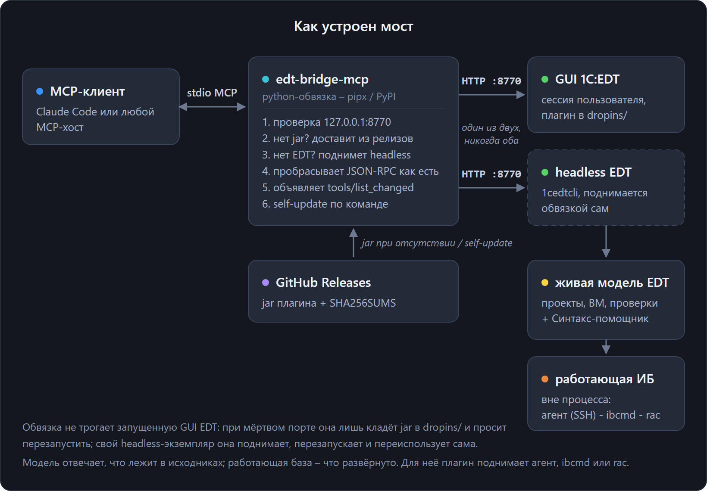

# edt-bridge-mcp

[English](https://github.com/keyfire/edt-bridge/blob/main/python/README.md) · **Русский**

stdio MCP-обвязка для плагина [edt-bridge](https://github.com/keyfire/edt-bridge) к 1C:EDT.

Java-плагин отдает MCP как простой JSON-RPC по HTTP на `127.0.0.1:8770`. Значит, MCP-клиент,
настроенный на этот адрес, теряет сервер всякий раз, когда EDT не запущена. Вместо адреса клиент
разговаривает с этой обвязкой:

- **EDT открыта**, с интерфейсом или headless, и каждый запрос передается работающему мосту;
- **EDT закрыта**: обвязка запускает headless EDT через `1cedtcli` с поддерживающим конвейером,
  как в `scripts/run-headless.ps1`. После загрузки модели запросы передаются мосту;
- **jar плагина нет**, и обвязка **сама доставляет его** из последнего релиза GitHub, с проверкой
  контрольной суммы, в `dropins/` EDT перед запуском. Одного `pipx install edt-bridge-mcp`
  достаточно, чтобы мост заработал;
- Во время запуска моста `tools/list` возвращает пустой список, чтобы клиент не ожидал загрузки.
  Когда мост готов, поступает `notifications/tools/list_changed`.



## Установка

```bash
pipx install edt-bridge-mcp        # или из рабочей копии: pipx install ./python
```

## Регистрация в MCP-клиенте

```bash
claude mcp add edt-bridge -- edt-bridge-mcp --workspace "D:\\путь\\к\\workspace-EDT"
```

## Из командной строки

По умолчанию обвязка использует JSON-RPC через stdin и stdout для связи с MCP-клиентом. Подкоманды
позволяют обращаться к мосту вручную или из скрипта. Они используют тот же поиск портов, токен и
автоматический запуск headless.

```bash
edt-bridge-mcp tools                    # что отдаёт запущенный мост
edt-bridge-mcp call edt_projects        # вызвать инструмент и напечатать результат
edt-bridge-mcp call edt_metadata_details --json '{"projectName": "SM", "fqn": "CommonModule.Foo"}'
edt-bridge-mcp call edt_create_extension --json-file args.json   # аргументы из файла UTF-8
edt-bridge-mcp status                   # поднят ли мост (сам ничего не запускает)
edt-bridge-mcp wait-ready --project Demo --timeout 3600   # пока не загрузится модель Demo
edt-bridge-mcp workspace pack --workspace <ws> --archive ready.tar.gz   # остановленная рабочая область для другой машины
```

`--raw` печатает результат в JSON вместо текста, который вернул инструмент. Аргументы берутся из
`--json`, `--json-file` или `--stdin`, и для аргументов с не-ASCII текстом на Windows надежнее файл.

Коды возврата: `0` – порядок, `1` – вызов вообще не состоялся (моста нет, ошибка использования или
транспорта), `2` – мост выполнил инструмент, и тот сообщил об ошибке. Так скрипт отличает "упало" от
"не запускалось". `wait-ready` возвращает `0`, когда проекты готовы, `1`, если EDT не запущена или
завершилась, и `2`, если срок истек, а EDT еще загружается.

## Самообновление

```bash
edt-bridge-mcp self-update             # обновить jar плагина (GitHub Releases) + обвязку (PyPI)
edt-bridge-mcp self-update --jar-only  # только jar
edt-bridge-mcp self-update --pip-only  # только обвязку
edt-bridge-mcp self-update --pip-only --from <repo>/python   # из рабочей копии
```

Запущенная EDT с интерфейсом или в режиме headless использует прежний jar до перезапуска. При
следующем автоматическом запуске headless обвязка использует обновленный jar.

`--from` ставит обвязку из локальной рабочей копии, а не с PyPI. Так пробуют невыпущенную сборку, не
прибегая к `pipx install --force`: тот пересоздает venv и заменяет exe, который держит запущенный
клиент.

Код возврата отделяет мост от его дополнений. `0` – обновилось все, что просили. `1` – не обновился
сам мост, jar или обвязка, либо не обновилось ничего. `2` – мост обновлен, а не встал только плагин
обвязки: плагин ставится из своего источника, и недоступность этого источника – не отказ моста
обновиться.

Обвязка обновляется распаковкой. Она загружает wheel-пакет с PyPI либо копирует пакет из рабочей
копии, указанной в `--from`, и заменяет пакет в `site-packages` с помощью стандартной библиотеки.
Pip, pipx и отдельный сборщик не требуются: pipx 1.15 создает venv через uv, и в таком venv нет pip.

## Плагины

Внешние пакеты, установленные в окружение обвязки, могут добавлять инструменты MCP. Например, они
могут содержать справочные материалы под чужой лицензией или инструменты внутренних сервисов. Обвязка находит их через группу точек расширения
`edt_bridge.tools`, перечисляет их инструменты рядом с инструментами моста и выполняет сама, поэтому
они отвечают даже без запущенной EDT.

```bash
pipx inject edt-bridge-mcp <пакет>   # установить плагин
edt-bridge-mcp plugins               # что подключено и почему плагин не загрузился
```

`EDT_BRIDGE_NO_PLUGINS=1` выключает поиск плагинов. Контракт объявления для авторов – на
[странице установки](https://docs.keyfire.ru/edt-bridge/ru/install#плагины-обвязки).

Файлы `.exe` в `Scripts` не заменяются: запущенный клиент может удерживать их на Windows.
При следующем запуске используется обновленный код из site-packages. `pipx_metadata.json` поправляется, чтобы `pipx list` не показывал старую версию.
Editable-установку обновление не перезаписывает, а отклоняет.

## Настройка

Флаги CLI имеют приоритет над переменными окружения.

| Переменная | Флаг | Смысл |
|-----|------|---------|
| `EDT_BRIDGE_PORT` | `--port` | порт моста (по умолчанию 8770) |
| `EDT_BRIDGE_TOKEN` | – | токен инструментов записи; передается в заголовке `Authorization: Bearer` и передается в JVM headless-экземпляра |
| `EDT_BRIDGE_WORKSPACE` | `--workspace` | путь к рабочей области EDT, обязателен для автозапуска headless |
| `EDT_BRIDGE_EDT_DIR` | `--edt-dir` | каталог установки EDT (папка с 1cedtcli и dropins); без него берется самая свежая установка |
| `EDT_BRIDGE_START_TIMEOUT` | `--start-timeout` | сколько секунд ожидать запуск моста (по умолчанию 360) |
| `EDT_BRIDGE_AUTOSTART` | `--no-autostart` | `0` или флаг – только пересылать запросы и ничего не запускать |
| `EDT_BRIDGE_HEAP` | `--heap` | наибольший размер кучи JVM для автоматически запущенной EDT, например `6g`; заменяет `-Xmx` установки |
| `EDT_BRIDGE_VMARGS` | `--vmargs` | другие параметры JVM для автоматически запущенной EDT через пробел; флаг передавать как `--vmargs=...` |

Редко нужные (`EDT_BRIDGE_PORT_SCAN`, `EDT_BRIDGE_WINDOW_WAIT`, `EDT_BRIDGE_LANG`) и переменные
самого плагина собраны в разделе
[Переменные окружения](https://docs.keyfire.ru/edt-bridge/ru/install#переменные-окружения).

## Безопасность

- Если **EDT с интерфейсом запущена, а порт моста недоступен**, обвязка не запускает headless EDT,
  поскольку рабочая область занята. Если плагин отсутствует, обвязка устанавливает его jar в
  `dropins/`; для активации моста следует перезапустить EDT.
- Если headless `1cedtcli` уже стартует, обвязка ждет его, а не порождает второй.
